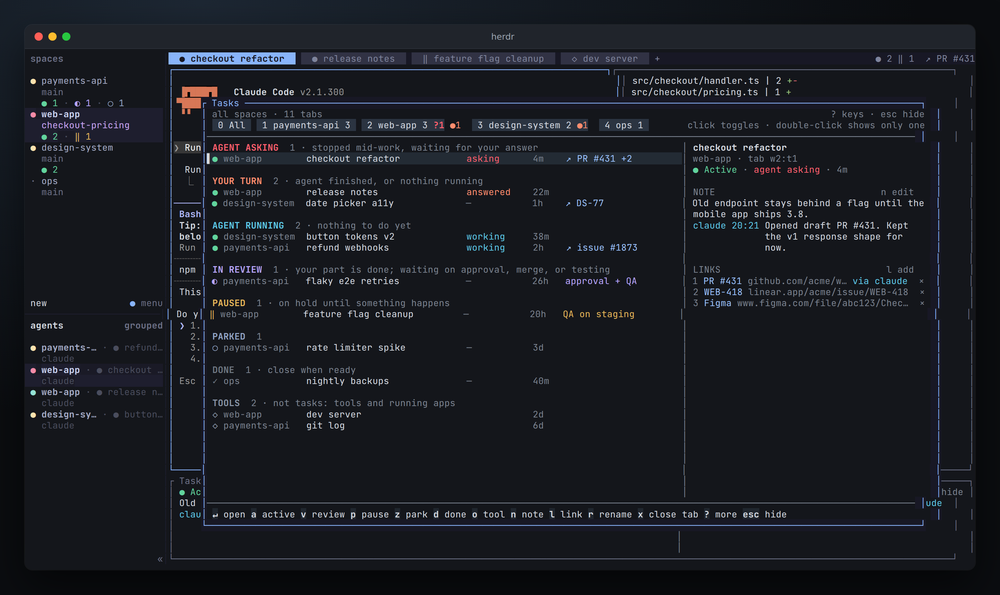
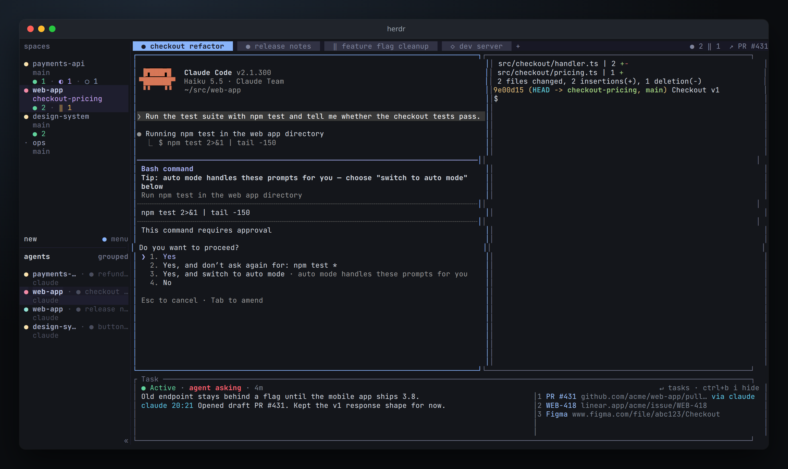
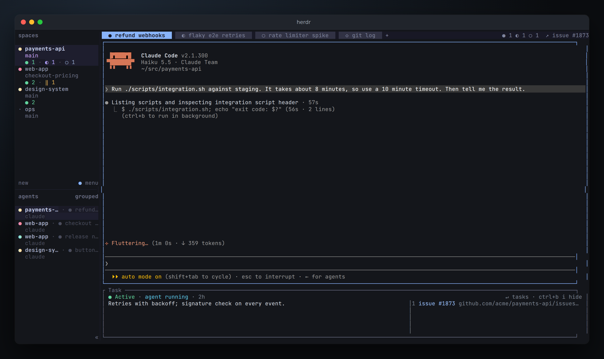

# herdr-tasks

A [herdr](https://herdr.dev) plugin that treats every tab as a task. Each tab gets a stage, a note, and links, and one overview shows every task across all spaces.

You set the stage. Agents never get a status from you: for active tasks, herdr's own agent detection decides whether it's your turn or the agent is still running.

| Stage | Marker | Use it for |
|---|---|---|
| Active | `●` | Work in progress. The overview splits it by what the agent is doing: **Agent asking** (stopped mid-work for your answer or approval, the most urgent), **Your turn** (finished, or nothing running), and **Agent running**. |
| In review | `◐` | Your part is done; waiting on approval, merge, or testing. Takes what it's waiting for. |
| Paused | `‖` | On hold until something happens: a PR review, QA, or your own decision. Takes a reason. |
| Parked | `○` | Started, but no time to follow up. |
| Done | `✓` | Finished. Close the tab from the overview when you're ready. |
| Tool | `◇` | Not a task: a tab that stays open for a tool like lazygit, or a running app. Sorted last, left out of the counts, listed under TOOLS at the bottom of the overview, and has no strip unless you turn one on. |



## What it adds to herdr

- **Task overview** (`ctrl+b t`): a popup listing every tab, grouped by stage, with the selected task's note and links. Filter by space, jump to a tab, change stages, edit the note, add links, close done tabs.
- **Strip** (on by default, `ctrl+b i` hides or shows it): a short pane along the bottom of each tab with the task's stage, what the agent is doing, the note, and links. Press `↵` in it to open the overview.
- **Tab bar**: a stage marker in front of each tab name, and tabs ordered active → in review → paused → parked → done → tools.
- **Tab bar, right side**: stage counts for the current space, and the current task's pause reason or first link.
- **Spaces sidebar**: stage counts under each space.

The Agents list is left alone.





The screenshots show real Claude Code sessions in throwaway demo repos.

## Install

Needs herdr 0.8.0+ and Go 1.23+ on the machine where herdr runs.

```bash
herdr plugin install alekkowalczyk/herdr-tasks
```

That clones the repo, builds it, and runs `herdr-tasks setup`, which:

- links `herdr-tasks` into `~/.local/bin`, for the tab bar status and for agents,
- adds `ctrl+b t`, `ctrl+b i`, the tab bar status, and sidebar counts to `~/.config/herdr/config.toml`, inside a marked `# >>> herdr-tasks` block. The tab bar line goes into your existing `[ui]` section. Your previous config is saved once as `config.toml.before-herdr-tasks`. Anything you already configure yourself (your own `tab_bar_right`, sidebar rows, or a binding on `ctrl+b t`) is left alone, and setup tells you what to add by hand,
- turns every tab in every running herdr session into an Active task, so tab names get a `●` in front (set `markers = false` below to keep tab names as they are), adds a strip along the bottom of each tab, and reloads the config.

Adding a strip to a tab with several panes briefly moves the other panes out to temporary tabs and puts them back in the same arrangement; their processes keep running. New tabs get their strip as soon as they're created. Updates restart running strips with the new version in place.

### herdr --remote

If you attach from another machine with `herdr --remote`, that machine uses its own key bindings by default, and herdr never sends a client's own custom-command bindings to the server. So `ctrl+b t` and `ctrl+b i` only work with the server's bindings. Attach with `--remote-keybindings server`:

```bash
herdr --remote ssh://you@server --session NAME --remote-keybindings server
```

The sidebar counts and the tab bar status come from the server's config in the setups tested so far. If they don't show up on your machine, merge the herdr-tasks lines into that machine's config over SSH (run this there; `config --unmerge` takes them out again):

```bash
f=~/.config/herdr/config.toml; mkdir -p ~/.config/herdr; touch "$f"; ssh you@server '~/.local/bin/herdr-tasks config --merge' < "$f" > "$f.new" && cp "$f" "$f.before-herdr-tasks" && mv "$f.new" "$f"
```

Without the keys, the strips and tab markers still work, and `↵` in a strip opens the overview.

### Remove

```bash
herdr-tasks remove
```

Gives tabs their plain names back, clears the sidebar counts, takes the marked block out of your config, and uninstalls the plugin. Notes and links stay in `~/.local/state/herdr/plugins/herdr-tasks` unless you add `--purge`.

### Working on the plugin

`make link` builds this checkout, runs setup, and links it into herdr instead of a GitHub install. `make unlink` removes it.

## The overview

| Keys | Mouse | Does |
|---|---|---|
| `↑` `↓` / `j` `k` | click, wheel | select a task |
| `↵` | double-click | jump to the tab |
| `a` `v` `p` `z` `d` `o` | | set Active, In review (asks what for), Paused (asks why), Parked, Done, Tool |
| `n` | | edit the note (`ctrl+s` saves, `esc` cancels) |
| `l` / `L` | `×` next to a link | add a link / remove one |
| `r` | | rename the task (also renames the tab) |
| `x` | | close the tab (Done tasks only) |
| `1`–`9` | click a space chip | hide or show that space |
| `shift`+`1`–`9` | double-click a chip | show only that space |
| `0` | click "All" | show all spaces |
| `esc` / `q` / `t` | | close the overview |

Space chips count agents asking (`?`) and tasks where it's your turn (`●`). If a hidden space has either, a line at the top of the list says so. The space filter is remembered between opens.

## Command line

Inside a herdr pane, commands apply to that pane's tab. Use `--tab ID` for another one.

```bash
herdr-tasks set parked
herdr-tasks review "approval + QA"
herdr-tasks tool
herdr-tasks pause "PR #212 review"
herdr-tasks note set "Old endpoint stays behind a flag until mobile ships."
herdr-tasks note add "Opened draft PR #431."          # a line with your name, or the agent's
herdr-tasks link add https://github.com/acme/api/pull/431
herdr-tasks link rm 1
herdr-tasks show
herdr-tasks list
```

### Letting agents add notes and links

An agent runs in a pane of its tab, so it can use the same commands. `note add` and `link add` record who added them (`claude` when run from Claude Code, or `--as NAME`). To have Claude do it, add this to `~/.claude/CLAUDE.md`:

```markdown
When running inside herdr (HERDR_ENV=1), record decisions on the current task with
`herdr-tasks note add "<text>"`, and attach every PR, ticket, or doc you create or rely on
with `herdr-tasks link add <url>`. Don't change the task's stage.
```

## Settings

`~/.config/herdr/plugins/config/herdr-tasks/config.toml`:

```toml
markers = true    # stage marker in front of tab names
sort_tabs = true  # order tabs active → in review → paused → parked → done → tools
strip = true      # a strip along the bottom of each tab
```

Run `herdr-tasks sync` after changing them.

## How it works

- State lives in `~/.local/state/herdr/plugins/herdr-tasks/<session>.json`, one file per herdr session, keyed by tab ID. herdr keeps tab IDs across restarts. If a tab still gets a new ID, a named task follows it by space and name.
- herdr runs `herdr-tasks hook` on startup and when tabs or spaces are created, closed, renamed, or moved. Each run brings markers, order, and sidebar counts in line. Sidebar counts don't survive a herdr restart, so the startup hook reports them again.
- Unnamed tabs keep showing their position number after the marker, and the plugin updates that number when tabs move.
- Renaming a tab yourself in herdr renames the task; the plugin puts the marker back.
- A strip is an ordinary pane labeled `Task` running `herdr-tasks strip`. After a herdr restart it comes back as a plain shell, and the startup hook starts the strip in it again. If everything else in a tab closes, the plugin closes the tab instead of leaving the strip alone in it. Closing a strip yourself counts as hiding it.

## Not yet

- A Claude Code hook that attaches every PR an agent opens.
- A notification with the task's note when you switch tabs.
- `ctrl+click` on a PR or ticket link to attach it to the task.
- PR review and check status from `gh`, and tasks moving on when a PR is approved or merged.
