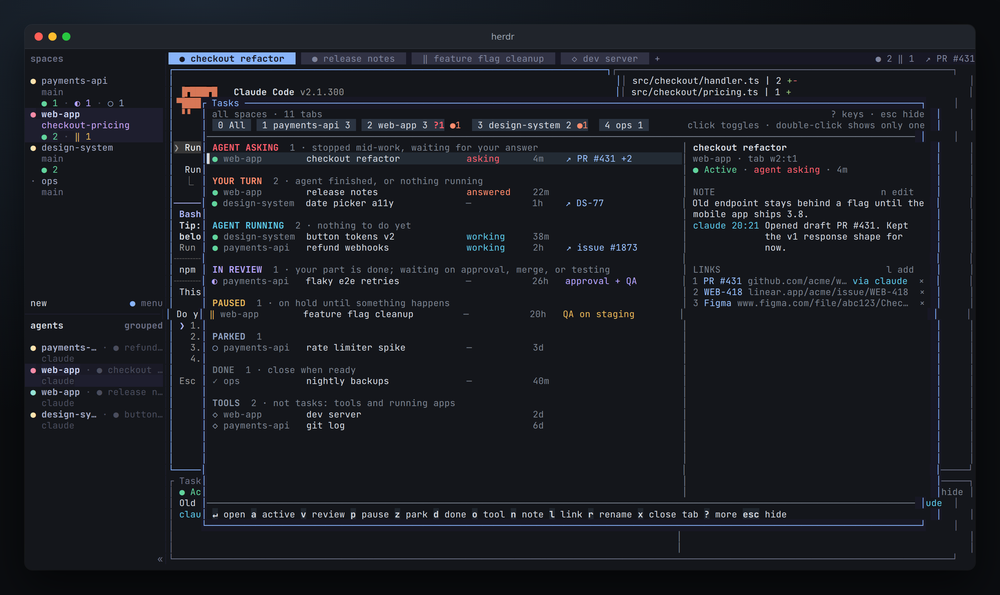
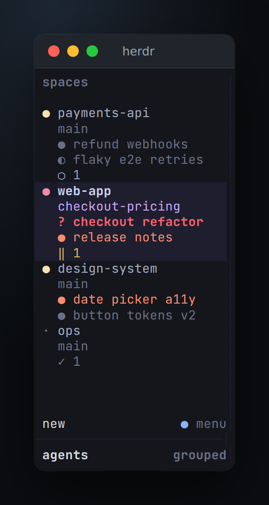
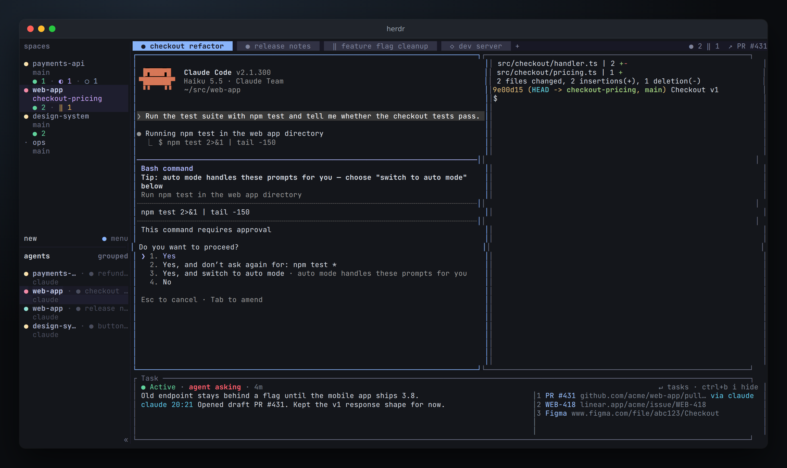
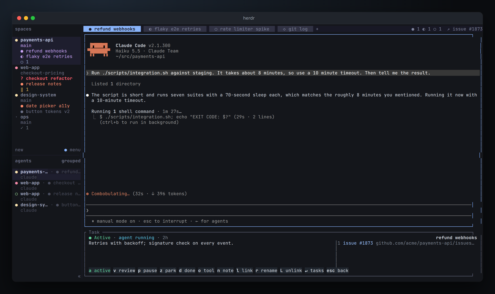
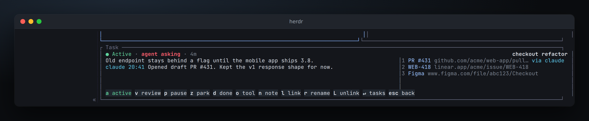

# herdr-tasks

A [herdr](https://herdr.dev) plugin that treats every tab as a task. Each tab gets a stage, a note, and links, and one overview shows every task across all spaces.

Any task that isn't done can also be a **priority** (`f`): it gets a red `!` and stays in the sidebar list whatever its stage.

You set the stage. Agents never get a status from you: for active tasks, herdr's own agent detection decides whether it's your turn or the agent is still running.

| Stage | Marker | Use it for |
|---|---|---|
| Active | `●` | Work in progress. The overview splits it by what the agent is doing: **Agent asking** (stopped mid-work for your answer or approval, the most urgent), **Your turn** (finished, or nothing running), and **Agent running**. |
| In review | `◐` | Your part is done; waiting on approval, merge, or testing. Takes what it's waiting for. |
| Paused | `‖` | On hold until something happens: a PR review, QA, or your own decision. Takes a reason. |
| Parked | `○` | Started, but no time to follow up. |
| Done | `✓` | Finished. Close the tab from the overview when you're ready. |
| Tool | `◇` | Not a task: a tab that stays open for a tool like lazygit, or a running app. Sorted last, left out of the counts, listed under TOOLS at the bottom of the overview, and has no strip unless you turn one on. |



## What it adds to herdr

- **Task overview** (`ctrl+b t`): a popup listing every tab, grouped by stage, with the selected task's note and links. Filter by space, jump to a tab, change stages, edit the note, add links, move a task to another workspace, close done tabs. Its LINKS are grouped under Linear, Slack, Pages and Links headings.
- **Strip** (on by default, `ctrl+b i` hides or shows it): a short pane along the bottom of each tab with the task's stage, what the agent is doing, the note, links, and buttons. Links sit in a column that uses the space the note leaves, grouped as Linear, Slack, Pages, and Links for the rest; a section spills onto spare rows, and a "+N" says how many more there are. `+` (or a click on the "+N") shows every link, grouped and numbered; when they don't all fit, `↑`/`↓` (or `k`/`j`) scroll it, and `+` or `esc` closes it. Click a button, or click into the strip and press its key, to change the stage (`a` `v` `p` `z` `d` `o`), make it a priority or not (`f`), edit the note (`n`, the strip grows while you type; `ctrl+s` saves), add a link (`l`), remove one (`L`, the strip grows and numbers every link; type the number and press `↵`), rename the task (`r`), move it to another workspace (`w`), or, for a Slack task, continue or start its research (`c`, `s`) and mute its channel (`m`). `↵` opens the overview, `esc` goes back to your work. After a change, focus returns to the pane above.
- **Tab bar**: a stage marker in front of each tab name, and tabs ordered active → in review → paused → parked → done → tools.
- **Tab bar, right side**: stage counts for the current space, and the current task's pause reason or first link.
- **Task board** (off by default, see [Settings](#settings)): every task of every running herdr session in your browser, one board per herdr session at `/<session>/`, with the list of sessions at `/`, in columns by stage and by what the agent is doing. Cards show each agent's state, its pane's name in herdr when it has one (with the agent's title under it), and Claude's latest recap, and the task's links grouped by kind: Linear issues with their status, Slack messages with their date, pages marked web, file or local, and other links. A local `.html` page opens in your browser from the board (see [Pages](#pages)). Drag a card to another column to change its stage. Hovering a workspace at the top lists its open tasks, priority first; click one to open it. **Priority only**, at the top right, shows only the priority tasks, and the browser remembers it. Open a card to see its tab's terminals, live, and type into them (see [Terminals on the board](#terminals-on-the-board)). The **Open task board** action in herdr opens this session's board, and so does `herdr-tasks board`; `herdr-tasks board --session NAME` opens another session's, and `herdr-tasks board` outside herdr opens the list. The card menu and the tab's view also have **Move to workspace…** and, for [Slack asks](#slack-asks), **Start research**, **Continue with my tools** and **Mute #channel** (**Mute this channel** for a DM).
- **Spaces sidebar**: each space's tasks under it, most urgent first: agents asking (`?`, red), then your turn (coral), then agents working (`↻`, blue) and in review. Priority tasks come before all of them, in red with a `!` in front, even when paused or parked. Other paused, parked, done, and tool tabs stay out of the list; a line under it counts the hidden ones by stage (`2 paused 1 parked`). `ctrl+b a` switches to plain stage counts and back.

The Agents list is left alone.









The screenshots show real Claude Code sessions in throwaway demo repos.

## Install

Needs herdr 0.8.0+ on Linux or macOS; the task board was built and tested with herdr 0.8.2. If Go 1.23+ is installed, the plugin is built from source; otherwise the matching release binary is downloaded and checked against the release's checksums.

```bash
herdr plugin install alekkowalczyk/herdr-tasks
```

That clones the repo, builds it, and runs `herdr-tasks setup`, which:

- copies `herdr-tasks` into `~/.local/bin`, for the tab bar status and for agents. A `herdr-tasks` already there that setup didn't put there, such as your own link to a checkout, is left alone; the tab bar status and the Claude links hook then run a copy in `~/.local/state/herdr/plugins/herdr-tasks/bin`,
- adds `ctrl+b t`, `ctrl+b i`, `ctrl+b a`, the tab bar status, and the sidebar rows to `~/.config/herdr/config.toml`, inside a marked `# >>> herdr-tasks` block. The tab bar line goes into your existing `[ui]` section. Your previous config is saved once as `config.toml.before-herdr-tasks`. If `config.toml` is a link, as into a dotfiles repo, setup changes the file it points at, keeps the backup next to that file, and leaves the link in place. Anything you already configure yourself (your own `tab_bar_right`, sidebar rows, or a binding on `ctrl+b t`) is left alone, and setup tells you what to add by hand,
- turns every tab in every running herdr session into an Active task, so tab names get a `●` in front (set `markers = false` below to keep tab names as they are), adds a strip along the bottom of each tab, and reloads the config.

Adding a strip to a tab with several panes briefly moves the other panes out to temporary tabs and puts them back in the same arrangement; their processes keep running. New tabs get their strip as soon as they're created. Updates restart running strips with the new version in place.

### herdr --remote

If you attach from another machine with `herdr --remote`, that machine uses its own key bindings by default, and herdr never sends a client's own custom-command bindings to the server. So `ctrl+b t` and `ctrl+b i` only work with the server's bindings. Attach with `--remote-keybindings server`:

```bash
herdr --remote ssh://you@server --session NAME --remote-keybindings server
```

The sidebar counts and the tab bar status come from the server's config in the setups tested so far. If they don't show up on your machine, merge the herdr-tasks lines into that machine's config over SSH (run this there; `config --unmerge` takes them out again):

```bash
f=~/.config/herdr/config.toml; mkdir -p ~/.config/herdr; touch "$f"; ssh you@server '~/.local/bin/herdr-tasks config --merge' < "$f" > "$f.new" && cp "$f" "$f.before-herdr-tasks" && mv "$f.new" "$f"
```

Without the keys, the strips and tab markers still work, and `↵` in a strip opens the overview.

### Remote herdr

The board is the way to see a remote machine's tasks and terminals without attaching. Two ways in: your tailnet, or an SSH tunnel. Both end at the same boards.

**Through your tailnet.** Add `board_tailnet = true` to the [settings](#settings). The board's server then shares itself with `tailscale serve`, and the machine's owner gets in by their Tailscale login, with no code. The address is `https://<machine>.<tailnet>.ts.net:7391/<session>/`, such as `https://devbox.tail0000.ts.net:7391/work/`. `herdr-tasks board` prints it when it can't open a browser, and `herdr-tasks board --print` prints the local address and then, on a second line, the tailnet one.

This needs a `tailscaled` that can reach the board's Unix socket: Linux, or the open-source `tailscaled` on macOS. The Mac App Store Tailscale app runs sandboxed and may not; use the SSH tunnel there. Tailscale also has to let your user change `serve`, once:

```bash
sudo tailscale set --operator=$USER
```

Your tailnet also needs HTTPS certificates, turned on once in the Tailscale admin console under DNS → HTTPS Certificates.

Until both are done, or when something else already uses the port (`Port 7391 is already shared with your tailnet for something else.`), the board says what's wrong in its header, and `herdr-tasks board` says it too: in the terminal, or on the overview's message line when you use **Open task board**. herdr-tasks never uses `tailscale funnel`, and never changes a `tailscale serve` entry it didn't make. If you turn Funnel on for the board's port, or a shared one, the board still answers only your tailnet.

Only the machine's owner is signed in this way. Anyone else on your tailnet who opens the address gets the sign-in page, and needs a code from `herdr-tasks board --print`.

**Through an SSH tunnel.** On your own machine, forward any free port to the board's port on the server, and open it:

```bash
ssh -N -L 8000:127.0.0.1:7391 you@server
```

Open `http://127.0.0.1:8000/<session>/`. To sign in, run `herdr-tasks board --print` on the server and open the address it prints with its port changed to 8000. The code works once, for a minute. Don't use local port 80: browsers leave `:80` out of the address, so the board can't tell it's the one you meant. Pick another, such as 8000.

#### Pages

A task's local `.html` links open from the board too, at an address under `/-/page/`, in a sandbox. The page's scripts run and it may load things from the internet. It can show the files in its folder (images, styles, other pages) but it can't read them from its scripts, and it can't reach the board. Secret-looking files (`.env`, keys, `.ssh` and the like, in any letter case) and hidden files are never served. A page in your home folder, above it, or in a hidden folder or a folder of keys under it, such as `~/.config`, gets only itself. Files can be up to 64 MiB. The address works until the board's server restarts. While the board is shared with your tailnet, a page's address works for anyone on your tailnet who has it, without signing in.

#### Sharing a `localhost` port

A task's link to `localhost:4100` points at the server's own port, which your laptop can't reach. On a board you opened through your tailnet, click such a link and the board asks, in the page, whether to share that port with your tailnet. Say yes and it opens at `https://devbox.tail0000.ts.net:4100/`. Each shared port shows in the board's header with a **Stop**. Shares come back after the board's server restarts. Turning `board_tailnet` off, or `herdr-tasks remove`, stops them, and takes out only the entries herdr-tasks made that still point at its own sockets.

Both http and https dev servers work (https goes over TLS to the local port), and so do WebSockets, so hot reload works. The board tries `127.0.0.1` and then `[::1]`. The dev server sees an ordinary local request: `Host: localhost:4100`, and an `Origin` of `http://localhost:4100` (`https://` for an https server). Its redirects to localhost are rewritten to the tailnet address.

While a port is shared, requests reach the dev server looking local. So anything it only allows from this machine, such as a debug console, is open to everyone on your tailnet. Tailscale's `Tailscale-User-*` headers, such as `Tailscale-User-Login`, reach it too. Share a port only when that's fine, and press **Stop** when you're done. Through an SSH tunnel, forward the dev server's port the same way instead.

#### Slack on one machine

Keep `slack_watch = true` on only the machine whose herdr session should get the asks. With it on in two places, each machine makes its own tasks, in its own session, for the same messages.

### Remove

```bash
herdr-tasks remove
```

Stops the task board, takes the board off your tailnet, gives tabs their plain names back, clears the sidebar counts, takes the marked block out of your config and the Claude links hook out of Claude Code's settings, and uninstalls the plugin. Notes and links stay in `~/.local/state/herdr/plugins/herdr-tasks` unless you add `--purge`, which also deletes the Linear key. If the task board doesn't stop, or the Claude links hook can't be taken out (other than because Claude Code's settings don't parse), `remove` changes nothing else and says why, so you can fix that and run it again. If Tailscale doesn't take the board off your tailnet, `remove` goes on, and names the `tailscale serve --https=<port> off` commands to run once it answers.

### Working on the plugin

`make link` builds this checkout, runs setup, and links it into herdr instead of a GitHub install. `make unlink` removes it.

## The overview

| Keys | Mouse | Does |
|---|---|---|
| `↑` `↓` / `j` `k` | click, wheel | select a task |
| `↵` | double-click | jump to the tab |
| `a` `v` `p` `z` `d` `o` | | set Active, In review (asks what for), Paused (asks why), Parked, Done, Tool |
| `f` | | make it a priority, or not (Done and Tool end it) |
| `n` | | edit the note (`ctrl+s` saves, `esc` cancels) |
| `l` / `L` | `×` next to a link | add a link / remove one (by its number: links are numbered in the grouped order everywhere) |
| `r` | | rename the task (also renames the tab) |
| `w` | | move the task to another workspace of the same herdr session |
| `m` | | mute the channel of a Slack task |
| `x` | | close the tab (Done tasks only) |
| `1`–`9` | click a space chip | hide or show that space |
| `shift`+`1`–`9` | double-click a chip | show only that space |
| `0` | click "All" | show all spaces |
| `esc` / `q` / `t` | | close the overview |

Space chips count agents asking (`?`) and tasks where it's your turn (`●`). If a hidden space has either, a line at the top of the list says so. The space filter is remembered between opens.

## Terminals on the board

**Open** on a card, or a click on the card, shows its tab: the tab's panes, live, laid out as in herdr and headed by their names in herdr, and the whole card next to them (stage, priority, note, log, links, and each agent's recap, last prompt and last reply). The task strip is left out. The address is `/<session>/#tab=<tab>`, so a reload keeps the view. **Back**, or `esc` when no terminal has focus, goes back to the board.

Click a pane to type into it; it gets an outline. Keys such as `enter`, `esc`, `tab`, the arrows, `F1`–`F12` and `ctrl`/`alt` combinations go to herdr by name, so herdr sends them the way the pane's program expects. Text goes as typed, and a paste goes in one piece. With a terminal focused, `esc` goes to the terminal. Cmd shortcuts stay with the browser: `cmd+c` copies selected text and `cmd+v` pastes. On Linux, `ctrl+shift+c` (or `ctrl+insert`) copies and `ctrl+shift+v` (or `shift+insert`) pastes, as in a terminal; `ctrl+c` goes to the pane. On macOS, Option types the letters it makes (`ą`, `ł`, `é`…), except in the chords terminal programs use: `option` with `b`, `d`, `f`, `p`, `t`, `y` or `.`, or with `enter`, `backspace`, `esc`, `tab` and the arrows, goes to the pane as `alt` (`option+b` is `alt+b`). If herdr turns something down, a note says so, and whatever you typed after it is dropped rather than sent late.

What it can't do:

- Resize panes. Each pane shows at its size in herdr, and the tab is scaled to fit the window.
- Scroll back. The browser shows what herdr shows; if you scrolled a pane back in herdr, it shows that, with a "scrolled back in herdr" badge.
- Use the mouse in terminal apps. Clicks and the wheel aren't sent. Dragging selects text, and the pane holds still while text is selected, until you type or paste into it.
- Show the cursor. herdr doesn't say where it is.
- Send Home, End, Page Up, Page Down, Delete and Insert in the pane's own key mode: herdr has no names for them, so they go as the usual sequences, which shells and Claude Code accept.

Screens are snapshots taken several times a second, so fast output can look choppy. If herdr quits while you watch, the view says the session isn't running rather than keep showing its last screens. Emoji with a variation selector, and joined emoji, can be one cell off in width; only their row shifts.

## Command line

Inside a herdr pane, commands apply to that pane's tab. Use `--tab ID` for another one.

```bash
herdr-tasks set parked
herdr-tasks review "approval + QA"
herdr-tasks tool
herdr-tasks pause "PR #212 review"
herdr-tasks priority                                   # off: herdr-tasks priority off
herdr-tasks note set "Old endpoint stays behind a flag until mobile ships."
herdr-tasks note add "Opened draft PR #431."          # a line with your name, or the agent's
herdr-tasks link add https://github.com/acme/api/pull/431
herdr-tasks link add docs/plan.html                    # a file, as a file:// link
herdr-tasks link rm 1                                  # by the number show gives it
herdr-tasks move Backend                               # move the tab and its task to another workspace
herdr-tasks show
herdr-tasks list
herdr-tasks board                                      # open this session's board in your browser
herdr-tasks board --session work                       # another session's board
herdr-tasks board --print                              # print its address instead (it works once, for a minute), and the tailnet one when shared
herdr-tasks board --new-token                          # sign every browser out of the board
herdr-tasks linear-key                                 # save a Linear API key, for issue status on the board
herdr-tasks slack status                               # the Slack watcher's state; starts the server if it isn't running (while slack_watch is on)
herdr-tasks slack fetch                                # check Slack for asks now, even with the watcher off
herdr-tasks slack skipped                              # the asks that made no task: off-topic, or maybe answered
herdr-tasks slack take 1                               # make the task for one of them
herdr-tasks slack mutes                                # the muted channels
herdr-tasks slack unmute billing                       # take one off the list
herdr-tasks slack research                             # start research in this tab, if it hasn't run
herdr-tasks slack continue                             # continue this tab's research with your own tools
```

### Letting agents add notes and links

An agent runs in a pane of its tab, so it can use the same commands. `note add` and `link add` record who added them (`claude` when run from Claude Code, or `--as NAME`). To have Claude do it, add this to `~/.claude/CLAUDE.md`:

```markdown
When running inside herdr (HERDR_ENV=1), record decisions on the current task with
`herdr-tasks note add "<text>"`, and attach every PR, ticket, or doc you create or rely on
with `herdr-tasks link add <url>`. Don't change the task's stage.
```

`link add` fails, and saves nothing, when the URL has a control character or isn't a valid URL, such as one with a stray `%` in its path (write it as `%25`). The strip and the overview say "Not a valid link".

### Links Claude adds

With `claude_links = true` in the [settings](#settings), what Claude Code works with is linked to the task without Claude being asked, as added by `claude`, and only when Claude runs in a herdr pane:

- **Linear issues** Claude opens, creates, updates, comments on, or attaches a file to (`get_issue`, `save_issue`, `save_comment`, `create_attachment`), from any Linear MCP server, and issue links you paste into a prompt. Searches and lists don't count, and neither do issues that another issue only mentions.
- **Slack links** you paste into a prompt: messages, threads and channels on `*.slack.com/archives/…`, Enterprise Grid included. Also the messages Claude posts with a Slack MCP `slack_send_message`. Slack links in Claude's replies don't count, since digest and summary skills reply with lists of them.
  A Slack link says where, who and what, as far as it's known: `Oct 28 12:59 #billing · Dana Reed: can you check…`. The labels come from the ask itself, from the messages Claude sends, from channel names the watcher and Claude sessions' Slack searches have seen, and from Slack search results in a session that match a link already on the task. A search never adds a link.
- **Pages**: HTML artifacts, visualizations, explainers and showcases.
  - Artifacts Claude publishes with the Artifact tool, labeled with the page's title. When it publishes a local file, the task shows the artifact instead of the file.
  - localhost URLs, claude.ai artifacts, and pages on static hosts (`*.github.io`, `*.gitlab.io`, `*.vercel.app`, `*.netlify.app`, `*.pages.dev`, `*.web.app`, `*.firebaseapp.com`, `*.surge.sh`) in your prompt or Claude's reply. Other web links don't count.
  - `.html` files named in your prompt or Claude's reply, or opened in a browser tool (`navigate` to a `file://` or localhost URL). A name counts when it looks like a path (absolute, or starting with `~/`, `./` or `../`, or containing `/`), and the file is a whole page (`<!doctype html` or `<html`).
  - Whole `.html` pages Claude writes or edits, unless they're templates or sit in a source, build or dependency folder (`src`, `templates`, `static`, `node_modules`, `dist`, `build`, `public`, and so on). A subagent's files don't count.

Each link is added once, whatever form its URL takes: a Slack message with or without `?thread_ts`, an artifact with or without its share key, localhost with or without a trailing `/`. Different hash routes (`#/a`, `#/b`) are different pages.

If you remove a link (`link rm`, `L` in the overview or strip, or `×` on the board), it stays off that task: neither the hook nor an agent running `link add` puts it back (`link add` says so). Removing a published artifact also keeps its file off, and the other way round. Adding the link yourself brings it back.

Limits:

- A localhost or static-host link is never saved when it has a user name or password, a parameter whose name holds `token`, `code`, `key`, `secret`, `pass`, `auth`, `sig`, `session` or `jwt`, or an OAuth callback path. A Linear issue link is saved without a user name, password, query or fragment, and an artifact link keeps only its share key.
- One prompt, reply or tool call adds at most 20 links, and looks at no more than 200 files.
- Once a task has 60 links, Claude adds no new ones, and `claude-hook.log` says so once. It still fills in and replaces the links the task has.

Comments and attachments name only the issue's ID, and so does a `get_issue` call whose result leaves out the URL (Claude asks for a few fields only). Their links are built from the Linear workspace of an issue link seen before, in any herdr session. Until one has been seen, those calls are skipped and noted in `claude-hook.log`.

`herdr-tasks setup` adds the hook to `~/.claude/settings.json` (or `$CLAUDE_CONFIG_DIR/settings.json`) for tool calls (`PostToolUse`), your prompts (`UserPromptSubmit`) and Claude's replies (`Stop`). It runs in the background, so it never holds Claude up. Setup leaves everything else in that file as it was. Your previous settings are saved once as `settings.json.before-herdr-tasks`. If the file doesn't parse, setup leaves it alone and says so. Turning `claude_links` off and running setup takes the hook out again, and so does `herdr-tasks remove`. Restart Claude Code sessions that are already running to pick up the change. That includes after a plugin update, which runs setup: 0.10.0 adds Slack searches to the tool calls the hook runs for, so it needs `herdr-tasks setup` (an update runs it) and a restart of running sessions. The hook never prints anything to Claude; problems go to `claude-hook.log` in `~/.local/state/herdr/plugins/herdr-tasks`.

Channel names seen in Slack searches and by the watcher are kept in `slack/channels.json` in that folder (at most 1,000), for labeling later links. This happens under `claude_links`, even while `slack_watch` is off.

## Slack asks

With `slack_watch = true`, herdr-tasks turns each Slack message that needs your answer into a task, without you opening Slack:

- A new tab in a workspace called "Slack inbox", in the background: no focus change, nothing typed into the tab you're in. The tab is named `<person>: <gist>`, and its note says who, where, when, and the message's first 500 characters, quoted. The task is Active and links to the message.
- A **research session** in that tab: Claude Code, started in `slack_cwd`, locked to reading. It reads the thread, looks for the facts, and ends with a write-up: the ask in one line, what it found with sources, what could be done, and a draft reply. It never posts, reacts or sends anything. You post.

How it finds them: every `slack_every` (5 minutes), within `slack_hours` (Mon-Fri 08:00-18:00, local time; `always` checks around the clock), the server runs a short headless Claude on Haiku that searches Slack through its connector. Slack is signed in the way Claude Code's Slack connector is, with `/mcp`; there is no Slack token to give herdr-tasks. herdr-tasks reads the search results itself and checks each message before it counts. The check can only read your Slack profile and search Slack.

### What counts

- Mentions of you in any channel you can read, threads included.
- DMs and group DMs. With `slack_dms = false`, those are skipped, and so are mentions inside them.
- Not counted: `@here`, `@channel`, `@everyone`, user-group mentions, your own messages, and messages from bots and apps.
- Already handled: a mention you replied to in the same thread, after it.
- A thread that has a task doesn't get a second tab, and neither does a DM conversation that has a task that isn't Done. The new message adds its link and a line to the task's log, and the task goes back to Active. This works wherever the task was moved.
- With `slack_topic`, only asks about that topic (see [Only asks about a topic](#only-asks-about-a-topic)).
- No backlog: the first check after turning it on starts from about that moment (it looks back up to 10 minutes), unless Slack was checked or fetched, or one was tried, within 72 hours (see [Fetch on demand](#fetch-on-demand)). After a gap (a night, a closed laptop, the Slack session, `default` unless `slack_session` names another, not running), the next check goes back at most 72 hours and takes at most 20 messages per check, then continues. `slack.log` names when a skipped period started.

Opt out of channels with `slack_skip_channels` (names or IDs), or from a task: **Mute #channel** on its board card or in its tab view (**Mute this channel** for a DM), or `m` in its strip or the overview, which confirms with the channel's name. Those mutes are kept in the plugin's state, not in your config file, which herdr-tasks never rewrites. `herdr-tasks slack mutes` lists both; `herdr-tasks slack unmute billing` takes one off the state's list. Muting a DM task mutes that conversation.

### Fetch on demand

A fetch checks Slack now, without waiting for the watcher, and takes what it finds into the "Slack inbox" workspace. It takes the asks the watcher would: mentions and DMs you haven't answered that don't have a task yet. That's what "unread" means here, since Slack's connector can't tell what you've read. There are three ways to fetch:

- `herdr-tasks slack fetch`, in any terminal;
- the **Fetch Slack asks** action in herdr;
- **Fetch** in the board's Slack line.

A fetch works while `slack_watch` is off, outside `slack_hours`, and before `slack_every` has passed. It delivers the way the watcher does: the same mutes, at most 20 asks, and at most `slack_max_new` research sessions an hour. It goes on from the last check. The first fetch, with no check before it, looks back 72 hours.

A fetch is one check. When there's more than one check can take, it says so, and you fetch again:

```
Fetching Slack asks…
Fetched from Fri 14:20: 3 new tasks, 2 with research; 1 added to a task. There's more: fetch again.
```

A fetch and the watcher never check at once, even from another terminal: the watcher skips its turn while a fetch runs, and a fetch waits for a check under way to end. `herdr-tasks slack fetch` gives up after 15 minutes (with `slack_topic`, one check can run 20 topic checks), and Ctrl-C stops it; a second Ctrl-C ends it at once. A fetch that fails says why, and `slack.log` has it; the watcher then backs off as after a failed check of its own.

The board's Slack line shows while the watcher is on, and while it's off once Slack was checked or fetched. Its **Fetch** reads "Fetching…" while the fetch runs, then shows the summary next to it for 15 seconds, or why it failed. One fetch from the board runs at a time. Closing the page doesn't stop it, and it gives up after 15 minutes too.

**Maybe answered.** A check sees only your newest 20 messages, so when you've written 20 since the check's start, it can't tell whether you answered an ask older than all of them. Such an ask gets no tab. It's marked seen, logged as "may be answered already", and goes on the [skipped list](#skipped-asks), without a topic check. One in a thread or DM that has a task still joins that task. A fetch that looks back 72 hours meets these most; its summary says how many there are. Taking one from the list says you haven't answered it: its task gets research as any other.

Turning `slack_watch` on goes on from the last check or fetch, or one that was tried, when that was within 72 hours, so the asks in between aren't lost. Otherwise it starts fresh. While a fetch runs, the watcher turns on once it's done.

### Only asks about a topic

With `slack_topic` set, only the asks about that topic become tasks. Say what counts in your own words, in at most 1,000 characters:

```toml
slack_topic = "the acme billing service: its code, deploys, incidents, data and APIs"
```

Each ask that would make a new task, except one you may have answered already, gets a topic check of its own: one Haiku run, capped at $0.05, that reads the topic and that one message, and answers whether the message is about the topic, and why in a few words. When it's unsure, the ask counts. Mentions, DMs and group DMs are checked alike. A message that joins a task already there, in its thread or DM, isn't checked: that conversation is yours already.

The topic check also reads the start of `CLAUDE.md` and `README.md` in `slack_cwd`, at most 4 KB in all, as background about the software. It skips them when `slack_cwd` is your home folder, and doesn't follow symlinks.

The topic check has no tools and no MCP servers (`--tools ""` and `--strict-mcp-config`), and the guard's `judge` profile lets it give its answer and nothing else. Its prompt, with the message, goes to Claude on stdin, not on the command line, where other users of the machine could read it. It takes at most a minute. When it fails, for any reason, the ask gets its task as if there were no topic, and `slack.log` says the topic wasn't checked. A topic check cut short because the fetch was stopped, with Ctrl-C or at its time limit, or because the server stopped, delivers nothing: that ask and the ones after it are taken by the next check.

An off-topic ask gets no tab. It's marked seen, logged as "off-topic (why)", and goes on the [skipped list](#skipped-asks).

### Skipped asks

An ask that's off-topic, or that you may have answered already, makes no task. It goes on a list of skipped asks: the newest 50, for 7 days. A fetch's summary and `herdr-tasks slack status` say how many there are. An ask that falls off the list, past 50 or after 7 days, is logged in `slack.log` as "dropped from the skipped list". It's marked seen, so no check finds it again: after that, only `slack.log` has it.

```
$ herdr-tasks slack skipped
#2 Oct 29 09:00 #billing · Dana Reed: the refund? — may be answered already
   https://acme.slack.com/archives/C0123ABCD/p1793264400000100
#1 Oct 28 12:59 #billing · Dana Reed: lunch on Friday, the usual place before… — off-topic: lunch plans
   https://acme.slack.com/archives/C0123ABCD/p1793192340000100
herdr-tasks slack take <#> makes its task.
$ herdr-tasks slack take 1
Took it: new tab w2:t1, with research
```

`herdr-tasks slack take` takes the number from that list, with or without the `#`, or the message's link. An ask keeps its number while it's on the list, so a newer skip, or a take, doesn't change which ask a number means. It makes the task as a check would have, without a topic check, and starts its research within `slack_max_new`. The ask then leaves the list.

On the board, the Slack line shows "2 skipped" while there are skipped asks. It opens the same list, newest first: each ask with why it was skipped, **Take**, which does what `slack take` does and says where the task went, and **Open in Slack**.

### Read-only until you continue

While the research session is locked, a hook (the guard) allows it only these:

- `Read`, `Grep` and `Glob`, for files inside `slack_cwd`;
- the Slack connector's read, search and list tools;
- Linear's get, list and search tools.

Everything else is refused: Bash, Edit and Write, web fetch and search, the harness's other MCP servers, Chrome, publishing artifacts, and every Slack and Linear tool that writes. It starts in plan mode, so it ends by presenting its write-up and waiting. Claude's own plan approval doesn't unlock anything.

What that leaves, plainly:

- The locked session can read every file under `slack_cwd`, and the default is your home folder. Point `slack_cwd` at a project folder without secrets.
- The research profile refuses the common secret files by name: `.ssh`, `.aws`, `.gnupg`, `.kube`, `.docker` and `.config/gcloud`, `.env` and `.env.*`, `.secrets` and `.secrets.*` (a file or a folder), `.netrc`, `.npmrc`, `.pypirc`, `*.pem`, `*.key`, and `id_rsa`, `id_ed25519` and `id_ecdsa` keys. It won't read those files and folders, or Grep with a glob that names them or matches every file. But a Grep over a folder still reads the matching lines of the files in it that aren't hidden, `certs/server.key` among them, so `slack_cwd` should be a folder without secrets. That list isn't every secret there is, either.
- A planted instruction could still put what the session reads into a Slack or Linear search query, which leaves your machine. So the folder matters.
- Claude Code 2.1.295 or later is needed: the lock's hooks fail closed from that version, so a guard that can't run, or takes over 10 seconds, blocks the call too. With an older Claude Code, checks and research don't start, and the watcher says why.

**Continue with my tools** ends the locked session and resumes the same conversation with none of the locks, so your own settings, permission mode and tools apply. It's the board's card menu and tab view, `c` in the strip, and `herdr-tasks slack continue` in the tab.

**A Slack message is untrusted input.** Colleagues, bots and Slack Connect guests can write anything, including instructions. The research prompt doesn't paste the message, and tells the session to treat it as quoted data, but a hostile message can still make the write-up misleading. Read the write-up, and its sources, before you choose **Continue with my tools**: the message stays in the conversation, and from then on the session has your tools.

### Your default model, and cost

The research session uses your default model, with no `--model` flag, and counts against your Claude usage limits like any session of yours.

The checks are Haiku runs capped at $0.05 each. Measured, they cost $0.001-$0.011 each, which is about $1 a working day at the defaults (a check every 5 minutes, 10 hours, 5 days a week). With `slack_topic`, each new ask adds a topic check, another Haiku run capped at $0.05. `herdr-tasks slack status` shows the last check's cost, its topic checks included.

At most `slack_max_new` research sessions start per hour (4). Past that, the task and tab are still made, without Claude; the task's log says why. **Start research** on the board, or `s` in the strip, starts it later (so does `herdr-tasks slack research` in the tab).

### Keys and commands

| Where | Does |
|---|---|
| Strip `c`, board **Continue with my tools** | continue the locked session with your tools |
| Strip `s`, board **Start research** | start research for a task that has none yet, or whose start was held or failed |
| Strip and overview `m`, board **Mute #channel** (**Mute this channel** for a DM) | mute the task's channel |
| Strip and overview `w`, board **Move to workspace…** | move the task to another workspace |

```bash
herdr-tasks slack status          # on or off, last check and its cost, any problem, muted channels, the topic
herdr-tasks slack fetch           # check now, even with the watcher off
herdr-tasks slack skipped         # the asks that made no task: off-topic, or maybe answered
herdr-tasks slack take 1          # make the task for one of them
herdr-tasks slack mutes
herdr-tasks slack unmute billing
herdr-tasks slack research        # for the tab you're in, or --tab ID
herdr-tasks slack continue
herdr-tasks move Backend          # any task, not only Slack ones
```

When a check fails (the connector isn't signed in, a usage limit, a timeout after 2 minutes), the watcher says so and backs off: 5, 10, 20 minutes, then every 30. The board's header shows "Slack: last check 14:32", or the problem and since when. The tab bar shows `Slack ⚠` while there's a problem, in the tabs of the Slack session (`slack_session`, or herdr's default session), and in every session while that one isn't running. Everything skipped or failed goes to `slack.log`.

### Moving tasks

**Move to workspace…** (board), `w` (strip, overview) and `herdr-tasks move <workspace>` move a tab's panes, except the strip, to another workspace of the same herdr session, with their processes running, Claude included. The task keeps its stage, note, links, priority, and the Slack thread it answers. A tab with several panes comes back as side-by-side splits. herdr can't move panes between sessions, which are separate servers.

herdr's own keys for moving panes don't know about tasks. A task moved that way starts empty in its new tab.

### Turning it on

```toml
slack_watch = true
slack_session = "work"      # the herdr session for the Slack tabs; "" is herdr's default session
slack_cwd = "~/acme-harness"
```

Then run `herdr-tasks slack status`. It prints the watcher's state, and starts the server if it isn't running (while `slack_watch` is on), even with `board = false`. Changes to the slack settings take effect within 30 seconds while the server runs. Asks go to herdr's default session unless `slack_session` names another. While that session isn't running, the watcher waits, and `status` and the board say so. Turning `slack_watch` on again within 72 hours of the last check or fetch, or one that was tried, goes on from there; after longer, it starts fresh, with no backlog, like the first time.

Upgrading: before, with `slack_session` unset, asks went to the only herdr session that was running. Now they go to herdr's default session. If you relied on the old way, set `slack_session` to that session's name.

## Upgrading to 0.11.0

- Boards are now one per herdr session, at `/<session>/`, with the list of sessions at `/`. A bookmark of the old address opens the list, and one of a tab's view (`/#tab=<session>/<tab>`) opens that view on its session's board. `herdr-tasks board` opens this session's board.
- Slack asks now go to herdr's default session unless `slack_session` names another. See [Turning it on](#turning-it-on).
- The new `board_tailnet` setting is off, so nothing reaches your tailnet until you turn it on (see [Remote herdr](#remote-herdr)).

## Settings

`~/.config/herdr/plugins/config/herdr-tasks/config.toml`:

```toml
markers = true       # stage marker in front of tab names
sort_tabs = true     # order tabs active → in review → paused → parked → done → tools
strip = true         # a strip along the bottom of each tab
claude_links = false # link the Linear issues, Slack links, and pages Claude works with to the task
board = false        # serve the task board on 127.0.0.1
board_port = 7391    # the board's port
board_tailnet = false # also share the boards with your tailnet
slack_watch = false        # check Slack for asks
slack_session = ""         # the herdr session for Slack tabs; "" is herdr's default session
slack_workspace = "Slack inbox"  # its workspace
slack_cwd = ""             # where research sessions start; "" is the home folder
slack_dms = true           # DMs and group DMs count
slack_skip_channels = []   # channel names or IDs never to make tasks for
slack_every = "5m"         # how often to check
slack_hours = "Mon-Fri 08:00-18:00"  # when to check, local time; "always" checks around the clock
slack_max_new = 4          # research sessions started per hour
slack_topic = ""           # only asks about this make tasks; "" takes every ask
```

Run `herdr-tasks sync` after changing `markers`, `sort_tabs`, or `strip`. Run `herdr-tasks setup` after changing `claude_links`. The board's server reads `board`, `board_port` and `board_tailnet` every 10 seconds, and stops when the board and `slack_watch` are both off, or the port moves. To start it after turning the board on or changing its port, run `herdr-tasks board`, or restart herdr.

## How it works

- State lives in `~/.local/state/herdr/plugins/herdr-tasks/<session>.json`, one file per herdr session, keyed by tab ID. Only you can read it, or anything else in that folder, as it holds your notes and the share keys of artifact links. herdr keeps tab IDs across restarts. If a tab still gets a new ID, a named task follows it by space and name.
- herdr runs `herdr-tasks hook` on startup and when tabs or spaces are created, closed, renamed, or moved. Each run brings markers, order, and sidebar counts in line. Sidebar counts don't survive a herdr restart, so the startup hook reports them again.
- Unnamed tabs keep showing their position number after the marker, and the plugin updates that number when tabs move.
- The sidebar list is up to 7 rows per space, sent as workspace metadata tokens (`$t1`…`$t7`, with `_ask`, `_you`, `_run`, and `_pri` variants so asking, your-turn, working, and priority tasks can each be colored). A hook on agent status changes keeps it current.
- Renaming a tab yourself in herdr renames the task; the plugin puts the marker back.
- A strip is an ordinary pane labeled `Task strip` running `herdr-tasks strip`. After a herdr restart it comes back as a plain shell, and the startup hook starts the strip in it again. If everything else in a tab closes, the plugin closes the tab instead of leaving the strip alone in it. Closing a strip yourself counts as hiding it.
- The task board is one server, `herdr-tasks serve`, for every herdr session on this machine. herdr's startup hook starts it when `board = true`, and so does `herdr-tasks board`. Either one replaces a server that an older build left running. It listens on 127.0.0.1 only, and on Unix sockets in its state folder when `board_tailnet` is on (see below). It stops when no herdr session has run for 3 minutes, and logs to `board/board.log` in `~/.local/state/herdr/plugins/herdr-tasks`.
- Browsers won't open `file://` links from a web page, so a file link on the board is a button that opens the page through the board, at an address under `/-/page/` that works until the board's server restarts. It's sandboxed: its scripts run, but it can't reach the board. See [Pages](#pages) for what is and isn't served. Next to it, the card's view has a **Copy path** button. The board does this only for a file that's one of that task's links, and still a regular `.html` or `.htm` file once symlinks are followed.
- With `board_tailnet = true`, the server also listens on `board.sock`, a Unix socket in its state folder, and `tailscale serve` points the tailnet's port at it. Each shared `localhost` port gets a socket of its own (`share-<port>.sock`). What `tailscale serve` entries herdr-tasks made is recorded in `board/tailnet.json`. That door trusts the `Tailscale-User-Login` header that `tailscale serve` adds, and only there: the loopback door ignores it. The sockets are readable only by you. `herdr-tasks remove` and turning `board_tailnet` off take out only the entries in that record that still point at these sockets.
- Signing in to the board: `herdr-tasks board` asks the server for a code that works once, within a minute, and opens the board with it. The page swaps the code for a key and keeps it. The key works until the server stops, so after a restart, as when no herdr session has run for 3 minutes or after an update, the board asks you to sign in again. On the tailnet address, the machine's owner is signed in again without being asked. The server's own token is `board-token` in `~/.local/state/herdr/plugins/herdr-tasks`. `herdr-tasks board --new-token` replaces it, which signs every browser out.
- With a Linear API key, the board shows the status of linked issues; a read-only key is enough. `herdr-tasks linear-key` reads it from stdin, or asks for it without showing what you type. On macOS it's kept in your login keychain; on Linux, in `linear-api-key` in the state folder, readable only by you. `herdr-tasks linear-key --delete` removes it. The board's server reads the key once and keeps it, so it doesn't ask the keychain every minute; `herdr-tasks linear-key` tells it to read the key again. While the keychain can't be read, as when it's locked, the server asks it again after 5 minutes, then less often, up to once an hour.
- The Slack watcher runs in the board's server, which now runs when `board` or `slack_watch` is on, and stops when both are off. Its state is `slack/state.json` in `~/.local/state/herdr/plugins/herdr-tasks`: your Slack ID, the last check and its cost, any problem, the backoff, the messages it has seen (for 96 hours), the muted channels, the hourly start count, and the skipped asks. `slack/check.lock` keeps the watcher and a fetch from checking at once. The thread a task answers is kept on the task, in the session's state file. `slack.log` is in that folder itself. Both are readable only by you.
- Slack checks, topic checks and research sessions run Claude with `--settings` that add a PreToolUse hook, `herdr-tasks slack-guard`, with one of three profiles: `watch` (read your Slack profile, search Slack), `judge` (give the topic check's answer, nothing else) and `research` (read files inside `slack_cwd`, read Slack and Linear). Any error in the guard blocks the call. The settings are `slack/watch-settings.json`, `slack/judge-settings.json` and `slack/research.json` in the state folder.
- herdr reads a plugin's actions when it's installed or linked. After updating herdr-tasks, run `herdr plugin link` again, or restart herdr, to get new actions such as Fetch Slack asks.

## Not yet

- Attaching every PR an agent opens, the way the Claude links hook attaches issues and pages.
- A notification with the task's note when you switch tabs.
- `ctrl+click` on a PR or ticket link to attach it to the task.
- PR review and check status from `gh`, and tasks moving on when a PR is approved or merged.
